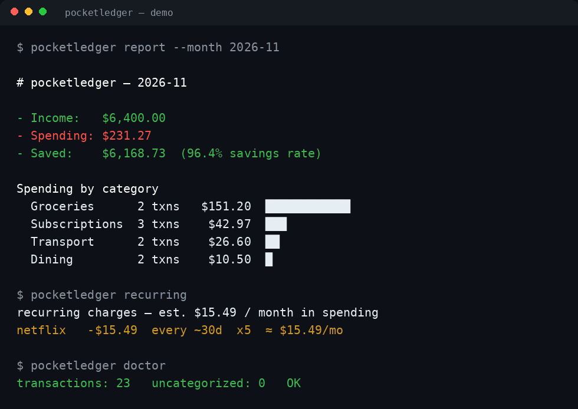

# pocketledger — a local-first personal finance ledger

**Your money, your disk, your rules.** Import bank CSVs, auto-categorise spending, set budgets, audit your subscriptions, and track net worth — with zero dependencies, zero accounts, and zero data leaving your machine.

[](https://github.com/BidyutRoy2/pocketledger/actions/workflows/ci.yml)
[](LICENSE)
[](https://www.python.org/)
[](pyproject.toml)
[](docs/privacy.md)



> **Try it in 60 seconds** — no real bank data needed:
>
> ```bash
> git clone https://github.com/BidyutRoy2/pocketledger.git
> cd pocketledger
> bash examples/demo.sh
> ```

## Why pocketledger?

Budgeting apps want your bank login, your data on their servers, and a
monthly fee. pocketledger is the opposite: a single SQLite file on your
disk, CSVs you export yourself, and no subscription — for a tool whose
whole job is to *find* your subscriptions.

| | pocketledger | Typical budgeting app |
|---|---|---|
| Bank login required | ❌ Never — CSV import | ✅ Usually |
| Your data stored | On your disk only | On their servers |
| Monthly cost | $0, forever | $5–15/month |
| Dependencies | Zero (stdlib only) | — |
| Works offline | ✅ Fully | ❌ Mostly |
| Subscription audit | ✅ Built in | ✅ Often paywalled |

## Quickstart

```bash
# Install from source (the package is not on PyPI yet)
git clone https://github.com/BidyutRoy2/pocketledger.git
cd pocketledger
python3 -m pip install -e .

# Create a ledger with a first account and starter rules
pocketledger init --account Main --starter-rules

# Import a bank CSV — columns auto-detected, duplicates skipped
pocketledger import ~/Downloads/bank-statement.csv --account Main

# See where the money went
pocketledger report --month 2026-11

# Find the subscriptions quietly charging you
pocketledger recurring
```

## What it does

- **Bank CSV import that just works** — automatic column detection
  (single `Amount` or split `Debit`/`Credit`), DD/MM and MM/DD dates,
  European decimals, and fingerprint dedupe so re-importing the same
  file adds nothing. See [docs/importing.md](docs/importing.md).
- **Auto-categorisation that learns** — 27 starter rules, plus
  `categorize --learn "Corner Bakery" Dining` teaches the ledger from
  your corrections. Longest-match wins; nothing is ever guessed silently.
- **Budgets with honest status** — monthly caps per category, OK / WATCH
  (≥80%) / OVER. Unbudgeted categories are never nagged about.
- **Subscription audit** — `pocketledger recurring` finds charges that
  repeat every month and totals them. The average household forgets
  2–3 subscriptions; this is the report that pays for the tool (which
  costs $0).
- **Reports you can open anywhere** — Markdown, JSON, or a self-contained
  dark-mode HTML dashboard ([preview](assets/preview.html)).
- **Net worth tracking** — balance snapshots per account, no bank login.
- **Exact money math** — amounts are integer cents in SQLite. No floats,
  no rounding drift, ever.

## Example session

```
$ pocketledger import bank.csv --account Main
imported: 18
skipped duplicates: 0
auto-categorised: 17 transactions

$ pocketledger budget --set Groceries 400 --month 2026-11
budget set: Groceries $400.00 / month (2026-11)

$ pocketledger report --month 2026-11
# pocketledger — 2026-11
- Income:   $6,400.00
- Spending: $231.27
- Saved:    $6,168.73 (96.4% savings rate)

$ pocketledger recurring
recurring charges — est. $15.49 / month in spending
netflix   -$15.49  every ~30d  x5  ≈ $15.49/mo

$ pocketledger doctor
transactions: 23   uncategorized: 0   OK
```

## Commands

| Command | What it does |
|---|---|
| `init` | Create a ledger, optional first account + starter rules |
| `account add/list` | Manage accounts |
| `add` | Add one transaction |
| `import <csv>` | Import a bank CSV (auto-detect, dedupe) |
| `list` | List transactions (filter by month / category / account) |
| `categorize` | Apply rules; `--learn <payee> <category>` teaches a rule |
| `rule add/list/delete` | Manage categorisation rules |
| `budget` | Set and check monthly spending caps |
| `report` | Monthly report — Markdown, JSON, or HTML |
| `recurring` | Subscription audit |
| `balance` / `networth` | Balance snapshots and net worth |
| `export` | Export everything as CSV or JSON |
| `doctor` | Ledger health check |

Full docs in [`docs/`](docs/index.md): [quickstart](docs/quickstart.md),
[importing](docs/importing.md), [categories](docs/categories.md),
[budgets](docs/budgets.md), [recurring](docs/recurring.md),
[privacy](docs/privacy.md), [FAQ](docs/faq.md), [limits](docs/limits.md).

## Privacy

pocketledger makes **no network calls at all** — no telemetry, no sync,
no update check. Your ledger is a SQLite file on your disk. It never asks
for bank credentials and could not use them. See [docs/privacy.md](docs/privacy.md).

## FAQ

**Does it connect to my bank?**
No. You export a CSV from your bank and import it.

**Where is my data?**
In `~/pocketledger/ledger.db` (or the directory you pass with
`--ledger`). One SQLite file — copy it to back up, delete it to start over.

**My bank's CSV didn't import.**
Read the `skipped bad rows` lines — they name the row and the reason.
Common cause: an unrecognised header name. Open an issue with the header
row (amounts removed) and it will be added.

**Does it give financial advice?**
No. It reports what you spent; it never tells you what to buy, sell, or
invest in.

**How is this different from YNAB / Mint / Monarch?**
Those hold your data on their servers and charge monthly. This one holds
your data on your disk and charges nothing. The trade-off: you export
CSVs yourself.

## Development

```bash
python3 -m unittest discover -s tests -v   # 77 tests, zero dependencies
bash examples/demo.sh                       # end-to-end demo on sample data
python3 tools/make_assets.py               # regenerate terminal-demo + social preview
```

See [CONTRIBUTING.md](CONTRIBUTING.md). Money is integer cents, never
floats; local-first is non-negotiable.

## License

MIT — see [LICENSE](LICENSE).
